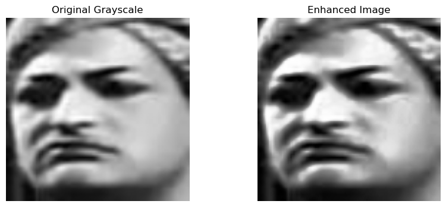
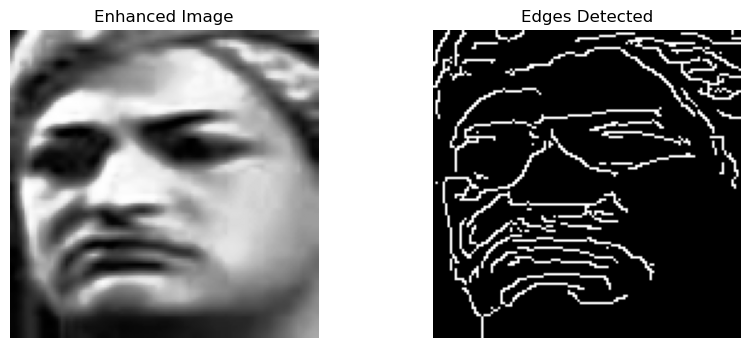
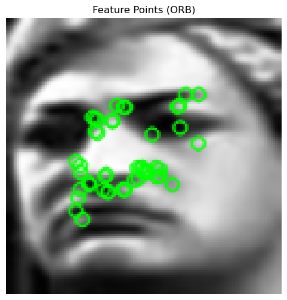
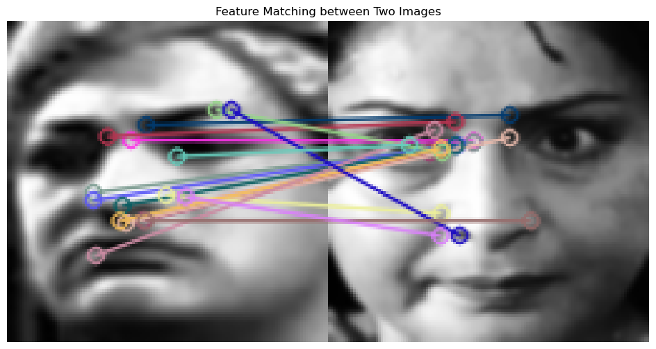

# Face Image Enhancement and Feature Matching with OpenCV

A classical computer vision pipeline applied to **19,906 grayscale face images**: contrast enhancement,
edge detection, noise reduction, keypoint extraction and feature matching. The project studies how each
preprocessing step changes what a feature detector can find in an image.

## Pipeline
| Step | Method | Purpose |
|---|---|---|
| 1. Preprocessing | Resize to 128 x 128, convert to grayscale | Uniform input size, faster processing |
| 2. Contrast enhancement | Histogram equalization (`cv2.equalizeHist`) | Spread pixel intensities to reveal detail in dark and bright regions |
| 3. Edge detection | Canny (thresholds 100 / 200) | Find facial contours and boundaries |
| 4. Noise reduction | Gaussian blur (5 x 5 kernel) | Suppress noise before feature extraction |
| 5. Keypoints | ORB detector and descriptors | Locate distinctive, repeatable points |
| 6. Matching | Brute-force matcher, Hamming distance, cross-check | Pair similar descriptors across two images |

## Results
- **Contrast:** histogram equalization raised the average brightness across the dataset from **91.8 to 128.7**
  (on a 0 to 255 scale), centring the intensity distribution.
- **Keypoints:** ORB detected **about 43 keypoints per image** on average (first 10 processed images).
- **Matching:** 17 cross-checked matches were found between two images of **different people**. Many of the
  match lines cross, which shows that most of these correspondences are not anatomically meaningful.

| Canny edges | ORB keypoints |
|---|---|
|  |  |

## Observations and limitations
- At 128 x 128 resolution, faces contain few strong corners, so ORB finds relatively few keypoints.
- Matching two different faces mostly produces incorrect correspondences. Keypoint matching on its own is
  not a reliable way to compare identities; learned face embeddings would be needed for that.
- In this version, Canny is applied before Gaussian smoothing. Smoothing first would usually give cleaner edges.

## Possible extensions
- Compare matching on two images of the **same** person versus different people.
- Filter matches with Lowe's ratio test and RANSAC to remove outliers.
- Measure how each preprocessing step changes keypoint count and match quality.

## How to run
1. Install the requirements: `pip install opencv-python numpy matplotlib`
2. Open `Face_Image_Processing_OpenCV.ipynb` and set `base_dir` in the first code cell to the folder
   that contains your face images.
3. Run all cells.

## Tools
Python · OpenCV · NumPy · Matplotlib

---
Author: [Hafza Noor](https://github.com/hafzanoor)
